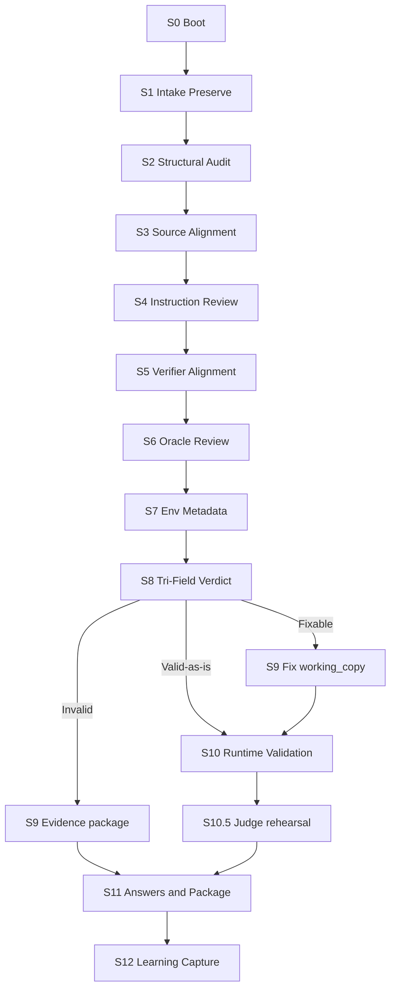

# Sentinel Submitter Workflow

Canonical stage list for submitter work. Stage **names are Sentinel-native** (not Terminal-Bench steps).

Each stage file under `workflows/stages/` defines: Purpose, Inputs, Outputs, Validation, Failure, Recovery, Automation.

```text
S0  Framework Boot
S1  Intake & Preserve
S2  Structural Harbor Audit
S3  Source Alignment (PR / commit / issue)
S4  Instruction Quality Review          ← expert
S5  Verifier Alignment (coverage ↔ faithfulness)  ← expert
S6  Oracle Faithfulness Review          ← expert
S7  Environment & Metadata Gates
S8  Tri-Field Verdict                   ← expert ONLY
S9  Branch Execution (Fixable / Valid-as-is / Invalid)
S10 Deterministic Runtime Validation
S10.5 Judge rehearsal (judge_prep + two-pass panel sim)  ← before package
S11 Platform Answers & Package
S12 Learning Capture                    ← framework improvement
```

## Mode routing

| User intent | Stages |
|-------------|--------|
| New ZIP + metadata | S0→S12 (first pass) |
| Difficulty / Judge / Logs revision | S0, S1 (preserve), S3–S7 delta, S8–S12 |
| Reviewer assignment | Separate reviewer workflow (read-only); do not run S9 Fixable packaging |

## Diagram



## Expert vs automation

| Stage | Expert judgement required? | Automation allowed |
|-------|----------------------------|--------------------|
| S1–S2, S7, S10–S11 packaging | Low (verify outputs) | High |
| S10.5 judge_prep | Low (verify map / decisions) | High (deterministic) |
| S10.5 rehearsal | High (axis scores) | Prompt module only |
| S3–S6 | High | Assist only (fetch PR, list files) |
| S8 | **Always human/agent expert** | Record only |
| S9 Fixable content | High | Hygiene helpers only |
| S12 | Medium | Proposal files only; never auto-merge into policy |

## Handoff rule

Do not claim a later stage complete if an earlier stage’s **Validation** failed, unless the failure is explicitly waived in `session/` with reason (and still never invent rewards).

## Judge-prep backtest control note

There is currently **no Valid-as-is package** in local history, so discrimination checks for
`judge_prep` / S10.5 have used post-fix Fixable `working_copy` trees as a weak control.
**Re-run the backtest control against the first genuinely Valid-as-is task we intake** before
trusting gap/overreach pile comparisons as evidence of calibrations.
